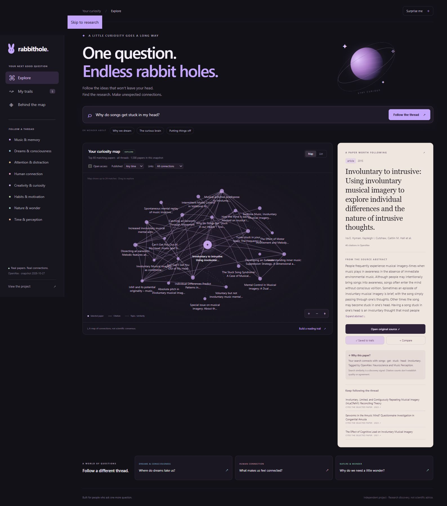

# RabbitHole

**One question. Endless rabbit holes.**

I built RabbitHole for the moment when a small question turns into an hour of clicking through tabs. Why do songs get stuck in my head? Why does time feel different when I'm absorbed in something? What makes people feel connected?

I wanted a way to follow those questions through real research, see how papers connect, and leave myself a useful trail to come back to.

[**Open the interactive Figma app**](https://www.figma.com/make/AJhaZiufnubi0QBAiJPasT) · [My demo walkthrough](docs/DEMO.md) · [Methods and limitations](docs/METHODOLOGY.md)



## What I built

- A searchable snapshot of **1,598 research papers**, **518 topics**, and **2,437 directed citation links** from OpenAlex.
- An interactive research map that distinguishes actual citations, shared topics, and text similarity.
- **BM25 + 48-dimensional latent semantic search**, implemented in Python and ported to the browser.
- A supervised **pairwise ML reranker trained on 13,785 comparisons**, with an explicit experimental mode and a model card documenting its held-out result.
- Side-by-side paper comparisons, relevance/diversity-based reading suggestions, local saved collections, and Markdown bibliography export.
- A **77-country research atlas** with thread filters and ArcGIS-compatible GeoJSON export, using public-domain Natural Earth boundaries.
- A normalized **SQLite database with FTS5**, source provenance, integrity checks, and a reproducible offline rebuild.
- An external retrieval evaluation on **5,183 SciFact documents and 300 held-out queries**, including raw query metrics and a paired bootstrap analysis.

The app runs without accounts, API keys, an LLM service, or a backend. I also included a read-only local Python API and SQL queries so the data and retrieval layers can be inspected independently.

## Try it

Download the repository and open **`app/index.html`** in a modern browser. All research data and search weights are bundled locally. Original paper links require an internet connection.

For a local web preview and optional API, install Python 3.11 or later and NumPy:

```bash
python -m pip install -r requirements.txt
python run.py
python serve.py --port 8765
```

Open `http://127.0.0.1:8765`. The rebuild uses the checked-in compressed source snapshot; it does not need to fetch fresh research. `GET /api/health`, `/api/search?q=music%20memory`, and `/api/fts?q=music%20memory` expose the local analytical layer.

Start with **"Why do songs get stuck in my head?"** Then try the open-access filter, compare two papers, and build a reading trail. Press `/` to focus search. A list view provides a keyboard-friendly alternative to the graph.

## How I measured it

I selected the fusion weight on the official SciFact training split and evaluated it on the separate test split:

| Method | nDCG@10 | Recall@10 | MRR@10 |
|---|---:|---:|---:|
| BM25 baseline | 0.6660 | 0.7824 | 0.6337 |
| BM25 + LSA, train-selected weight 0.15 | **0.6714** | **0.7874** | **0.6391** |

The paired nDCG difference is **0.00546**, with a 95% bootstrap interval of **[-0.00129, 0.01241]**. That interval includes zero, so I don't treat the small observed increase as a proven improvement. SciFact is a biomedical retrieval benchmark; it does not establish curiosity-search relevance, scientific correctness, or better learning outcomes.

I also checked that the browser and Python implementations return matching top-ten paper IDs across eight queries. See [the validation record](docs/VALIDATION.md), [benchmark output](outputs/benchmark.json), and [per-query measurements](outputs/query_metrics.csv).

```bash
python scripts/verify.py
node tests/test_browser_engine.cjs
```

To rerun the external benchmark, download its separate source data first:

```bash
python scripts/fetch_data.py --benchmark
python scripts/benchmark.py
```

The fetcher is anonymous, caches successful responses, checks response schemas, and uses bounded retries. OpenAlex's anonymous budget may change or be shared with other callers. Re-fetching from a changing API creates a new snapshot; it does not reproduce the old source bytes. The locked source archive is what I use for exact offline rebuilds.

## The engineering choices

| Layer | What I implemented |
|---|---|
| Acquisition | Anonymous OpenAlex requests, fixed query manifest, SHA-256 source checksums, offline source archive |
| Data | ID-based deduplication, source provenance, abstract reconstruction, validation/quarantine, retraction flags |
| Storage | SQLite tables, constraints, foreign keys, normalized topic/citation relationships, FTS5 |
| Search | BM25, randomized LSA, transparent score fusion, documented question expansion |
| Graph analysis | Directed citations, PageRank with dangling-node handling, components, personalized ranking and path algorithms |
| Product | Responsive map/list interface, source panels, comparison dialog, saved trails, export |
| Evaluation | Train/test separation, nDCG/recall/MRR, 5,000 paired bootstrap resamples, browser/Python parity |
| Machine learning | Pairwise logistic ranking, train/development/test separation, exported weights, browser inference, model card |
| Geography | Institution-country aggregation, interactive atlas, WGS84 GeoJSON, normalized SQL country memberships |
| Companion analysis | Executed R and MATLAB PageRank replications and paired-metric analysis |

I ran the independent R and MATLAB analyses in [`replication/`](replication/); both matched Python's PageRank reference. The browser and Python implementations pass **64 automated tests**, including sixteen hybrid/ML ranking-parity query cases. See [VALIDATION.md](docs/VALIDATION.md).

The learned reranker scored **0.6436 nDCG@10**, below the hybrid baseline's **0.6714** on held-out SciFact queries. I kept hybrid as the default and exposed the learned model as an experimental comparison. I explain the training data, selection, failure to generalize, and deployment decision in the [model card](docs/MODEL_CARD.md).

The atlas runs without paid GIS software. [GIS.md](docs/GIS.md) explains the geographic measure, export format, and the distinction between free ArcGIS Online public accounts and licensed ArcPy.

## What I deliberately keep explicit

A citation is not agreement. Text similarity is not evidence that a claim is true. Citation counts are not quality scores. I show source abstracts and metadata rather than generating scientific answers or claiming that two papers contradict each other.

The snapshot is an English-language convenience sample across eight themes, not a complete literature review. Two retracted records are retained in the auditable data but excluded from discovery. Some abstracts and access links are missing, and source metadata can contain errors.

## Repository guide

```text
app/                 Offline runnable app and exported search model
src/rabbithole/      Python retrieval and graph algorithms
scripts/             Acquisition, build, evaluation, and verification
sql/                 Database schema and analytical queries
data/                Locked source archive and provenance manifests
outputs/             Measured metrics, reference calculations, test reports
replication/         Executed R and MATLAB analytical companions
tests/               Python and browser-engine tests
docs/                Method, attribution, validation, demo, and resume entries
```

I wrote a [short interview walkthrough](docs/DEMO.md) and [resume versions](docs/RESUME.md) that use the actual project measurements. My next steps would be independently judged curiosity queries, a usability study, and an evaluation against modern neural embeddings.

Software: MIT. Research data and linked papers have separate upstream terms; see [sources and attribution](docs/SOURCES.md).
